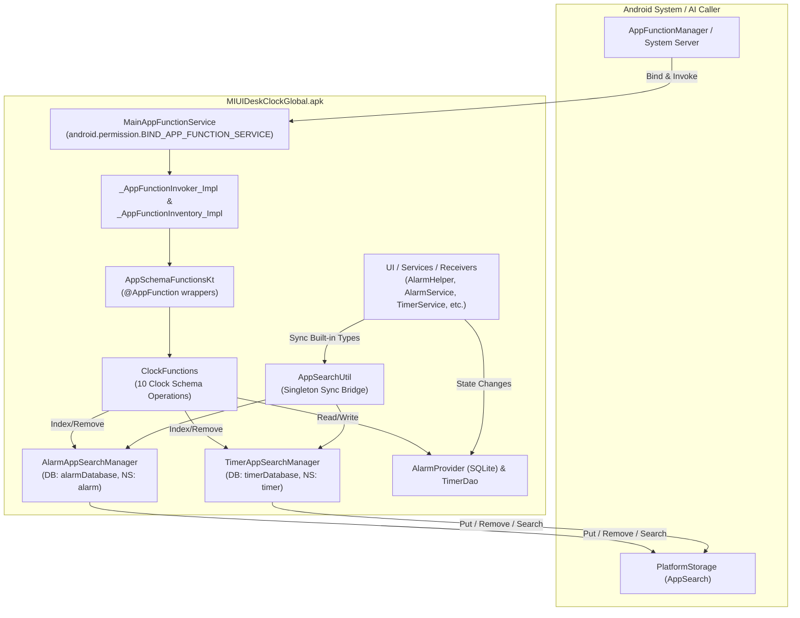

# DeskClock APK vs. Local AOSP Source Analysis

## 1. APK Extraction & Path Difference

While standard AOSP `DeskClock` (`product_specific: true` in [Android.bp](file:///home/hdyoon/aosp/packages/apps/DeskClock/Android.bp#L18-L41)) installs to `/product/app/DeskClock/DeskClock.apk`, the connected Xiaomi device (`dada_global`, model `24129PN74G`) ships `com.android.deskclock` at:
- `/product/data-app/MIUIDeskClockGlobal/MIUIDeskClockGlobal.apk` (also mirrored at `/data/app/~~12eR0YIBFQ5PzSwuD-t3Ng==/com.android.deskclock-z5I41MwYBAjy-IOKWEdRyQ==/MIUIDeskClockGlobal.apk`, SHA-256 `7f8d1c09603e22964044be3b777010f64b2067eed7c0d0e768be088f57bd1174`).

Extracted and decompiled reference files:
- Extracted APK: [MIUIDeskClockGlobal_product.apk](file:///home/hdyoon/.gemini/antigravity-cli/brain/b83f39bd-6fff-47d3-a9de-28d390a66ed2/scratch/MIUIDeskClockGlobal_product.apk)
- Decoded Manifest: [AndroidManifest_decoded.txt](file:///home/hdyoon/.gemini/antigravity-cli/brain/b83f39bd-6fff-47d3-a9de-28d390a66ed2/scratch/AndroidManifest_decoded.txt)
- AppFunctions XML schema: [app_function.xml](file:///home/hdyoon/.gemini/antigravity-cli/brain/b83f39bd-6fff-47d3-a9de-28d390a66ed2/scratch/unzipped/assets/app_function.xml)
- AIOS AppTools JSON schema: [app_tools.json](file:///home/hdyoon/.gemini/antigravity-cli/brain/b83f39bd-6fff-47d3-a9de-28d390a66ed2/scratch/unzipped/assets/app_tools.json)
- Disassembled Smali for all AppFunction / AppSearch / AI classes: [appaf_smali.txt](file:///home/hdyoon/.gemini/antigravity-cli/brain/b83f39bd-6fff-47d3-a9de-28d390a66ed2/scratch/appaf_smali.txt)

---

## 2. High-Level Comparison: Local AOSP Source vs. Device APK

| Aspect | Local AOSP Source ([AndroidManifest.xml](file:///home/hdyoon/aosp/packages/apps/DeskClock/AndroidManifest.xml)) | Device APK ([AndroidManifest_decoded.txt](file:///home/hdyoon/.gemini/antigravity-cli/brain/b83f39bd-6fff-47d3-a9de-28d390a66ed2/scratch/AndroidManifest_decoded.txt)) |
| :--- | :--- | :--- |
| **Codebase** | Stock AOSP DeskClock (`android16-release`) | Xiaomi HyperOS / MIUI DeskClock Global (`v17.71.0`, code `1305007100`) |
| **SDK Versions** | `minSdkVersion=23`, `targetSdkVersion=30` | `minSdkVersion=26`, `targetSdkVersion=35`, `compileSdkVersion=35` |
| **Application / Entry** | `com.android.deskclock.DeskClockApplication` / `DeskClock` | `com.android.deskclock.DeskClockApp` / `DeskClockTabActivity` |
| **Storage / Provider** | `com.android.deskclock.provider.ClockProvider` (`exported="false"`, supports multiple timers in SQLite) | `com.android.deskclock.AlarmProvider` + `TimerDao` (single-timer architecture in prefs/provider) + Bedtime/Sleep/ShiftAlarm |
| **AppFunctions / AI** | **None** (0 references to `appfunctions`, `appsearch`, or `tool`) | **3 distinct integrations**: 1. Google/Android **AppFunctions + AppSearch** (`com.android.deskclock.appaf.*`) 2. AIOS **OSBot AppTool SDK** (`com.android.deskclock.tool.AlarmToolService`) 3. HyperOS **AI Action Provider** (`com.android.deskclock.MyAiActionProvider`) |

---

## 3. Deep Dive: `app-function` Architecture in the Device APK

The local AOSP source has no `app-function` support at all. In contrast, the device APK bundles `com.google.android.appfunctions` (v1 common clock schema + KSP-generated inventory/invoker) and `androidx.appsearch.builtintypes` (`Alarm`, `AlarmInstance`, `Timer`), implemented in package `com.android.deskclock.appaf`.

### A. Manifest & Asset Declarations
1. **Extension Library & Service** ([AndroidManifest_decoded.txt](file:///home/hdyoon/.gemini/antigravity-cli/brain/b83f39bd-6fff-47d3-a9de-28d390a66ed2/scratch/AndroidManifest_decoded.txt#L930-L944)):
   - Declares `<uses-library android:name="com.android.extensions.appfunctions" android:required="false" />`.
   - Exposes `com.google.android.appfunctions.service.MainAppFunctionService` protected by `android.permission.BIND_APP_FUNCTION_SERVICE`:
     - `<property android:name="android.app.appfunctions" android:value="app_function.xml" />`
     - Intent filters for both `android.app.appsearch.functions.AppFunctionService` and `android.app.appfunctions.AppFunctionService`.
2. **Declared Schema ([app_function.xml](file:///home/hdyoon/.gemini/antigravity-cli/brain/b83f39bd-6fff-47d3-a9de-28d390a66ed2/scratch/unzipped/assets/app_function.xml#L1-L94))**:
   - Exposes **10 functions** under `schema_category="clock"`, `schema_version="1"`, `enabled_by_default="true"`, `restrict_callers_with_execute_app_functions="false"`:
     1. `com.android.deskclock.appaf#ClockFunctions_createAlarm`
     2. `com.android.deskclock.appaf#ClockFunctions_showAlarm`
     3. `com.android.deskclock.appaf#ClockFunctions_updateAlarm`
     4. `com.android.deskclock.appaf#ClockFunctions_deleteAlarms`
     5. `com.android.deskclock.appaf#ClockFunctions_createTimer`
     6. `com.android.deskclock.appaf#ClockFunctions_showTimer`
     7. `com.android.deskclock.appaf#ClockFunctions_deleteTimers`
     8. `com.android.deskclock.appaf#ClockFunctions_updateTimer`
     9. `com.android.deskclock.appaf#ClockFunctions_findAlarms`
     10. `com.android.deskclock.appaf#ClockFunctions_findTimers`

### B. Implementation Details of the 10 AppFunctions (`ClockFunctions.kt`)
All 10 entry points in `AppSchemaFunctionsKt` ([appaf_smali.txt](file:///home/hdyoon/.gemini/antigravity-cli/brain/b83f39bd-6fff-47d3-a9de-28d390a66ed2/scratch/appaf_smali.txt#L1301-L1579)) instantiate `ClockFunctions` ([appaf_smali.txt](file:///home/hdyoon/.gemini/antigravity-cli/brain/b83f39bd-6fff-47d3-a9de-28d390a66ed2/scratch/appaf_smali.txt#L1580-L8249)) and delegate to its methods:

#### Alarm Operations
- **`createAlarm`** ([appaf_smali.txt](file:///home/hdyoon/.gemini/antigravity-cli/brain/b83f39bd-6fff-47d3-a9de-28d390a66ed2/scratch/appaf_smali.txt#L2189-L2983)):
  - Parses recurrence from `CreateAlarmParams.dayPattern`: either an iCalendar recurrence rule (`RRULE:FREQ=WEEKLY;BYDAY=MO,TU,...`) or a specific `Date` (checking that the target date/time is in the future, otherwise throwing `AppFunctionException(3501, "Create alarm failed")`).
  - Inserts into `Alarm.Columns.CONTENT_URI`, builds an `androidx.appsearch.builtintypes.Alarm` (namespace `"alarm"`) with `DataUtil.getAlarmInstance(...)`, indexes it via `AlarmAppSearchManager.addAlarm(...)`, and calls `AlarmHelper.setNextAlert(context)`.
- **`showAlarm`** ([appaf_smali.txt](file:///home/hdyoon/.gemini/antigravity-cli/brain/b83f39bd-6fff-47d3-a9de-28d390a66ed2/scratch/appaf_smali.txt#L5748-L6259)):
  - Looks up the alarm by `_id` (if numeric) or `external_id`, and returns an `AppFunctionOpenable` wrapping a `PendingIntent` to `DeskClockTabActivity` (`navigation_tab = 0`).
- **`updateAlarm`** ([appaf_smali.txt](file:///home/hdyoon/.gemini/antigravity-cli/brain/b83f39bd-6fff-47d3-a9de-28d390a66ed2/scratch/appaf_smali.txt#L6649-L7611)):
  - Supports state transitions (`SNOOZED` -> `AlarmHelper.snoozeAlarm`; `DISMISSED` while firing -> `AlarmHelper.dismissAlarm`; `DISMISSED` when not firing -> disables alarm via `AlarmHelper.enableAlarm(..., false)`), or modifies time/label in `ContentResolver` and re-indexes in AppSearch.
- **`deleteAlarms`** ([appaf_smali.txt](file:///home/hdyoon/.gemini/antigravity-cli/brain/b83f39bd-6fff-47d3-a9de-28d390a66ed2/scratch/appaf_smali.txt#L3683-L4183)):
  - Removes each alarm ID from `AlarmAppSearchManager` and deletes rows matching `_id = ? AND type = 0` from the `alarms` SQLite table.
- **`findAlarms`** ([appaf_smali.txt](file:///home/hdyoon/.gemini/antigravity-cli/brain/b83f39bd-6fff-47d3-a9de-28d390a66ed2/scratch/appaf_smali.txt#L4558-L5346)):
  - Queries `alarms` (`type = 0`), filters by `FindAlarmsParams` (startTime, endTime, label, status), and maps results to `com.google.android.appfunctions.schema.common.v1.clock.Alarm`.

#### Timer Operations (and MIUI-Specific Constraints)
Unlike AOSP DeskClock (which supports multiple concurrent timers with labels), MIUI DeskClock only supports a **single global timer** without labels via `TimerDao`. This leads to strict checks in `ClockFunctions`:
- **`createTimer`** ([appaf_smali.txt](file:///home/hdyoon/.gemini/antigravity-cli/brain/b83f39bd-6fff-47d3-a9de-28d390a66ed2/scratch/appaf_smali.txt#L2985-L3681)):
  - **Rejects any non-empty `label`** (`label.length > 0`) or **duration >= 24 hours (`86,400,000` ms)** by throwing `AppFunctionException(3501 / 0xdad, "Create timer failed")` (`ERROR_ACTION_NOT_SUPPORTED`).
  - Removes the previous single timer from `TimerAppSearchManager`, overwrites the timer via `TimerDao.insertTimer`, starts it if `startTimer == true`, and indexes `androidx.appsearch.builtintypes.Timer` (namespace `"timer"`).
- **`showTimer`** ([appaf_smali.txt](file:///home/hdyoon/.gemini/antigravity-cli/brain/b83f39bd-6fff-47d3-a9de-28d390a66ed2/scratch/appaf_smali.txt#L6261-L6647)):
  - Checks that `TimerDao.getTimer(context).state == 1` (running); if so, returns a `PendingIntent` to `DeskClockTabActivity` (`navigation_tab = 3`), else throws `AppFunctionException(3000, "Show timer failed")`.
- **`updateTimer`** ([appaf_smali.txt](file:///home/hdyoon/.gemini/antigravity-cli/brain/b83f39bd-6fff-47d3-a9de-28d390a66ed2/scratch/appaf_smali.txt#L7613-L8248)):
  - Rejects non-null `label` with error `3501`. Updates duration via `TimerDao.insertTimer` or sends internal broadcasts `action.timer_pause` (for `PAUSED`) / `action.timer_continue` (for `STARTED`), then updates `TimerAppSearchManager`.
- **`deleteTimers`** ([appaf_smali.txt](file:///home/hdyoon/.gemini/antigravity-cli/brain/b83f39bd-6fff-47d3-a9de-28d390a66ed2/scratch/appaf_smali.txt#L4185-L4556)):
  - Sends broadcast `function.timer_cancel` (if running/paused) or `function.timer_dismiss` and deletes the timer from `TimerAppSearchManager`.
- **`findTimers`** ([appaf_smali.txt](file:///home/hdyoon/.gemini/antigravity-cli/brain/b83f39bd-6fff-47d3-a9de-28d390a66ed2/scratch/appaf_smali.txt#L5348-L5746)):
  - Reads the single timer from `TimerDao.getTimer(context)` and returns it as a 1-element list if its state is active (`1`, `2`, or `3`).

### C. Continuous AppSearch Synchronization (`AppSearchUtil`)
Beyond direct AppFunction calls, the APK hooks `AppSearchUtil` ([appaf_smali.txt](file:///home/hdyoon/.gemini/antigravity-cli/brain/b83f39bd-6fff-47d3-a9de-28d390a66ed2/scratch/appaf_smali.txt#L9358-L10893)) into normal app lifecycle events so Android `PlatformStorage` (`alarmDatabase` and `timerDatabase`) always reflects live state (provided `UserManager.isUserUnlocked()` is true):
- **`AlarmDatabaseHelper` / `AlarmProvider`**: Calls `insertDefaultAlarmsToAppSearch()` on DB creation/reset and `addAppSearchAlarmScheduled()` on insert.
- **`SetAlarmController` / `AlarmClockFragment` / `MyAiActionProvider`**: Calls `updateAppSearchAlarmScheduled()`, `addAppSearchAlarmScheduled()`, and `deleteAppSearchAlarm()` when users or XiaoAi create/edit/delete alarms.
- **`AlarmService` / `AlarmHelper`**: Calls `updateAppSearchAlarmFiring()` when an alarm triggers, `updateAppSearchAlarmSnoozed()` on snooze, and `updateAppSearchAlarmDismissed()` on dismiss.
- **`TimerService` / `AlarmRingtonePickerActivity`**: Calls `addAppSearchTimer()`, `updateAppSearchTimerToPause()`, `updateAppSearchTimerToContinue()`, `updateAppSearchTimerToExpired()`, and `deleteAppSearchTimer()`.

---

## 4. Other Two AI / Agent Tooling Mechanisms in the Device APK

In addition to Google's `AppFunctions`, the APK includes two Xiaomi/AIOS-specific agent interfaces:

1. **AIOS OSBot AppTool SDK (`com.android.deskclock.tool.AlarmToolService`)**:
   - Declared in [AndroidManifest_decoded.txt](file:///home/hdyoon/.gemini/antigravity-cli/brain/b83f39bd-6fff-47d3-a9de-28d390a66ed2/scratch/AndroidManifest_decoded.txt#L912-L929) with action `com.aios.osbot.action.APP_TOOL_PROVIDER`, gated by permission `com.aios.osbot.permission.BIND_APP_TOOL`, and configured via `<meta-data android:name="com.aios.apptoolsdk.TOOL_CONFIG" android:value="app_tools.json" />`.
   - [app_tools.json](file:///home/hdyoon/.gemini/antigravity-cli/brain/b83f39bd-6fff-47d3-a9de-28d390a66ed2/scratch/unzipped/assets/app_tools.json#L1-L51) defines 4 JSON-RPC-style tools invoked via reflection on `AlarmToolService` ([appaf_smali.txt](file:///home/hdyoon/.gemini/antigravity-cli/brain/b83f39bd-6fff-47d3-a9de-28d390a66ed2/scratch/appaf_smali.txt#L13016-L14038)):
     - `alarm_query` -> `queryAlarms()`
     - `alarm_add` -> `addAlarm(hour, minutes, label, daysOfWeek, vibrate, enabled)`
     - `alarm_update` -> `updateAlarm(id, hour, minutes, label, daysOfWeek, vibrate, enabled)`
     - `alarm_delete` -> `deleteAlarm(id)`

2. **HyperOS AI Action (`com.android.deskclock.MyAiActionProvider` & `MyAiActionActivity`)**:
   - Declared in [AndroidManifest_decoded.txt](file:///home/hdyoon/.gemini/antigravity-cli/brain/b83f39bd-6fff-47d3-a9de-28d390a66ed2/scratch/AndroidManifest_decoded.txt#L662-L702) with authority `com.android.deskclock.MyAiActionProvider`, permission `hyperos.permission.READ_AIACTION`, and metadata `@xml/aiaction_data_provider` targeting `com.xiaomi.aicr`.
   - Handles voice/agent intents (`createAlarm`, `checkAlarm`, `deleteAlarm`, `editAlarm`) and explicitly calls `AppSearchUtil` to keep AppSearch synchronized.
